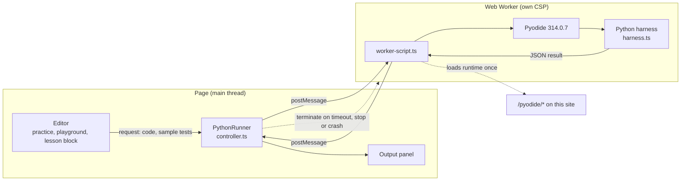

# DSA Academy

A private learning platform for teaching Data Structures and Algorithms. Enrolled students sign in and work through a phased curriculum of lessons, step-through algorithm visualizations, quizzes, coding problems and projects, attend live sessions, and receive instructor feedback. A public website presents the course, and an instructor area covers enrolment, progress, reviews and content editing.

Every topic is taught the same way: motivation, intuition, a visualization, a precise statement, pseudocode, a tested Python implementation, a correctness argument, a cost analysis, a worked example, practice, a self-assessment checklist and further reading. Lessons are written in Markdown with LaTeX mathematics and syntax-highlighted code.

The course is called "Data Structures and Algorithms". Its learning path has 8 phases and 34 modules. Six modules are published in full: two Python foundations modules (Python Module P1 and P2, 12 lessons), DSA Module 1, "Algorithms, correctness and cost" (5 lessons, 3 visualizations), and DSA Modules 2 to 4 on recursion and induction, arrays and amortised analysis, and linked lists (6 lessons each, with call-stack, dynamic-array and pointer-operation visualizations). Each published module has an assessment, a project and coding problems: 35 lessons, 6 quizzes, 6 projects and 31 coding problems in all. The other 28 modules are planned: they appear on the learning path by title, description and plan, clearly labelled, and open as they are written.

Students run Python directly in the browser: in a playground, in runnable examples inside lessons, and against the sample tests of each coding problem. Code never runs on the server.

## Contents

- [Features](#features)
- [Technology stack](#technology-stack)
- [Architecture](#architecture)
- [Repository structure](#repository-structure)
- [Local installation](#local-installation)
- [Environment variables](#environment-variables)
- [Curriculum structure](#curriculum-structure)
- [Student workflow](#student-workflow)
- [Coding practice](#coding-practice)
- [Running Python in the browser](#running-python-in-the-browser)
- [Python playground](#python-playground)
- [Algorithm visualizations](#algorithm-visualizations)
- [Instructor workflow](#instructor-workflow)
- [Database](#database)
- [Authentication](#authentication)
- [Progress and unlocking rules](#progress-and-unlocking-rules)
- [Security](#security)
- [Development](#development)
- [Testing](#testing)
- [Continuous integration](#continuous-integration)
- [Production deployment](#production-deployment)
- [Authoring course content](#authoring-course-content)
- [Rebranding](#rebranding)
- [Limitations](#limitations)
- [Possible extensions](#possible-extensions)

## Features

**Public website**

- Landing page with the course overview, the learning path grouped by phase, an instructor section and an FAQ
- Published and planned modules counted and shown separately, with counts read from the database
- Contact and help page with a validated, rate-limited form
- Student login. There is no public registration

**Learner portal** (`/learn`, sign-in required)

- Dashboard: next step, current phase and module, overall completion, coding practice, upcoming live session, projects due, feedback, quiz performance and announcements
- Curriculum as a learning path: collapsible phases, published modules with their lessons, quizzes and projects, and planned modules with their objectives and planned lessons
- Lesson pages with objectives, Markdown and LaTeX content, code with copy buttons, figures, embedded visualizations, video embeds, resources, previous and next navigation, and a collapsible curriculum sidebar (a drawer on small screens)
- Algorithm visualizations with play, pause, step forward and back, reset, speed, a scrubber, highlighted pseudocode, variables, operation counts and custom input
- Coding practice: a filterable list of problems, and for each one a statement, constraints, examples, hints revealed one at a time, a Python editor, Run code against the sample tests, draft saving, submission for self-review, submission history and an editorial
- Python in the browser: a playground with starter programs, and runnable, editable examples inside lessons, with output, errors, a time limit and a Stop button
- Quizzes with multiple choice, multiple select, true/false and short answer questions, server-side grading, a pass mark, explanations after submission, retakes and attempt history
- Projects with a brief, objectives, requirements, a rubric, a deadline, draft saving and submission
- Live sessions shown in the student's time zone, a resource library, a feedback inbox, a progress page, full-text search and profile settings
- Light and dark themes

**Instructor area** (`/admin`, instructor or admin role required)

- Student account creation and enrolment management, including pausing and restoring access
- Overview of every student's completion, and a submission queue with a review form
- Module management: rename, describe, assign to a phase, reorder, publish and unpublish
- Lesson, quiz and project editors with drafts and publishing, and lesson and question reordering
- Resource management, live session scheduling and announcements

## Technology stack

| Layer | Choice |
| --- | --- |
| Framework | Next.js 16 (App Router, React 19 server components and server actions) |
| Language | TypeScript, strict mode |
| Styling | Tailwind CSS 4 with semantic design tokens in `src/app/globals.css` |
| Database | PostgreSQL via Supabase, with row-level security |
| Authentication | Supabase Auth (email and password), cookie sessions through `@supabase/ssr` |
| File storage | Supabase Storage, one private bucket for course files |
| Python execution | Pyodide 314.0.7 (CPython 3.14 compiled to WebAssembly), in a Web Worker in the student's browser |
| Validation | Zod |
| Content rendering | `react-markdown`, `remark-gfm`, `remark-math`, `rehype-katex` (KaTeX), `rehype-highlight` |
| Tests | Vitest (unit and database integration), Playwright (end to end) |

The Python editor, the execution controller and the visualization player are written for this project. Pyodide is the only runtime dependency added for execution, and its files are served from this site.

## Architecture

```text
Browser
   |
   v
src/proxy.ts ............ sets a per-request Content-Security-Policy nonce, refreshes the
   |                      session cookie, and redirects visitors without a session away
   |                      from /learn/* and /admin/* to /learn/login
   v
Server components ....... read data with the signed-in user's own session
Server actions .......... validate input with Zod, then write
   |
   v
Supabase (PostgreSQL) ... row-level security decides what each user can read and write
```

Design decisions worth knowing before changing the code:

- **Authorisation is enforced in the database.** Every table has row-level security. The application layer checks permissions as well, but a student cannot read another student's progress, attempts, submissions, code or feedback even by calling the API directly.
- **One course per deployment, chosen by slug.** The public website, the student portal and the instructor area all resolve the course from `NEXT_PUBLIC_COURSE_SLUG`. Other courses in the database are ignored, so the three areas cannot disagree.
- **Quiz answers never reach the browser before submission.** Answer keys live in `question_keys`, a table students cannot read, and students have no insert privilege on `quiz_attempts`. Grading happens in a server action that reads the keys with the service role and stores the attempt.
- **Student code never runs on the server.** Not in the Next.js process and not in the database, which store and display it as text. It runs only in the student's own browser, inside a Web Worker that cannot reach the application (see [Running Python in the browser](#running-python-in-the-browser)).
- **Browser results are not grades.** Nothing about a run is sent to the server, and no status depends on it.
- **Editorials, reference solutions and hidden tests live in a separate table** that only staff can read. Students obtain an editorial through a database function that releases it after a submitted attempt.
- **Rules live in pure functions.** Completion, unlocking, the learning path, module numbering, practice status, quiz grading and the editor's text edits are plain TypeScript in `src/lib/domain`, with no database or clock access, and are covered by unit tests.
- **No client-side data fetching.** Pages are server-rendered per request. Client components are limited to interaction: the quiz runner, the code editor and Python runner, the visualization player, forms, drawers and the theme toggle.
- **The service-role key is used for four things only:** quiz grading, creating student accounts, the contact form with its rate limiter, and the seed script.
- **Lesson content is stored as Markdown in the database** and rendered on the server. Raw HTML in the source is not rendered.

## Repository structure

```text
supabase/
  config.toml                  local stack and auth settings
  migrations/                  schema, grants, row-level security, database functions
  templates/                   password-reset and invitation emails
seed/
  course.ts                    the curriculum blueprint: phases, modules, quiz, project, sessions
  python-foundations.ts        the two Python foundations modules
  exact-json.ts                JSON parsing that keeps large integers exact
  plans.ts                     objectives and planned lessons for modules not yet written
  lessons/*.md                 lesson bodies
  problems/<slug>/             one coding problem: statement, editorial, starter, solution, tests
  types.ts                     shape of a course definition
scripts/
  seed.ts                      loads seed/ into the database
  copy-pyodide.mjs             copies the Python runtime into public/pyodide (not committed)
  verify_content.py            runs every Python block in the lessons and every reference solution
src/
  proxy.ts                     Content-Security-Policy, session refresh and route protection
  config/site.ts               brand name, course slug, support email, navigation
  app/
    (site)/                    public website: landing page, contact
    learn/(auth)/              login, forgot password
    learn/(portal)/            dashboard, curriculum, lessons, practice, quizzes, projects, ...
    learn/actions/             server actions used by the portal
    learn/files/               signed links to private course files
    pyodide-worker/            serves the Python worker with its own Content-Security-Policy
    admin/                     instructor area
    auth/                      email-link confirmation and sign-out routes
  components/                  shared UI, the code editor and the visualization player
  lib/
    domain/                    progress, learning path, practice, quiz grading, editor (pure, unit tested)
    viz/                       algorithm tracers and the visualization block parser
    python/                    Python harness, worker source, execution controller, result types
    data/                      server-side queries
    supabase/                  clients, session handling, generated database types
    validation.ts              Zod schemas for every form
public/figures/                lesson figures
.github/workflows/ci.yml       continuous integration
tests/
  unit/, integration/, e2e/
```

## Local installation

Requirements: Node.js 22 or newer, Docker (for the local Supabase stack), and Python 3.10 or newer if you want to run the content verifier.

```bash
npm install        # also copies the Python runtime into public/pyodide

# 1. Start PostgreSQL, Auth, Storage and the API locally. Migrations are applied automatically.
#    The command prints the API URL and keys.
npm run db:start

# 2. Configure the app.
cp .env.example .env.local
#    Fill in NEXT_PUBLIC_SUPABASE_ANON_KEY and SUPABASE_SERVICE_ROLE_KEY from the output of
#    step 1 (npm run db:status prints them again), and choose a SEED_DEMO_PASSWORD.

# 3. Load the course and the demo accounts.
npm run seed

# 4. Run the app.
npm run dev
```

Open <http://localhost:3000>. The seed script creates three accounts, all with the password you set in `SEED_DEMO_PASSWORD`:

| Email | Role | State |
| --- | --- | --- |
| `student@example.com` | Student | Python lessons and assessments done; four of five DSA lessons, quiz passed on a retake, project reviewed, two problems submitted and one in draft |
| `student2@example.com` | Student | Python lessons done, assessments not taken; four of five DSA lessons, quiz not yet passed, project awaiting review, no practice yet |
| `instructor@example.com` | Instructor | Access to `/admin` |

Emails sent by the local stack (password resets) are captured at <http://127.0.0.1:54324>. Supabase Studio, a database browser, runs at <http://127.0.0.1:54323>.

If a local database was created from an earlier version of the schema, apply the newer migrations with `npx supabase migration up` and run `npm run seed` again. `npm run db:reset` rebuilds the database from scratch and deletes its data.

## Environment variables

Defined in `.env.local`, which is ignored by git. `.env.example` documents each one.

| Variable | Exposure | Purpose |
| --- | --- | --- |
| `NEXT_PUBLIC_SUPABASE_URL` | Public | Supabase API URL |
| `NEXT_PUBLIC_SUPABASE_ANON_KEY` | Public | Anon key, or the newer publishable key |
| `NEXT_PUBLIC_SITE_URL` | Public | Origin of the app, used in password-reset links and page metadata |
| `NEXT_PUBLIC_COURSE_SLUG` | Public | The one course this deployment presents, teaches and manages. Defaults to `data-structures-and-algorithms` |
| `NEXT_PUBLIC_SUPPORT_EMAIL` | Public | Optional. A real address shown for help requests. When empty, the site shows only the contact form |
| `SUPABASE_SERVICE_ROLE_KEY` | Server only | Service-role or secret key. Bypasses row-level security. Never expose it to the browser |
| `SEED_DEMO_PASSWORD` | Local only | Password for the demo accounts (at least 10 characters) |

## Curriculum structure

The curriculum is a hierarchy: course, phases, modules, then lessons, a quiz, a project and coding problems. It is defined in `seed/course.ts` and `seed/python-foundations.ts`, and can be edited afterwards in the instructor area.

| Phase | Modules |
| --- | --- |
| 1. Python foundations | **P1** Python essentials: values, control flow and functions (published); **P2** Python for algorithms: collections, mutability and testing (published) |
| 2. Foundations | **1** Algorithms, correctness and cost (published); **2** Recursion, induction and recurrences (published); **3** Arrays, dynamic arrays and amortised analysis (published); **4** Linked lists (published) |
| 3. Linear structures and sorting | **5** Two pointers; **6** Sliding window; **7** Stacks, queues and deques; **8** Elementary sorting and stability; **9** Divide and conquer: merge sort; **10** Quicksort, selection and randomisation; **11** Lower bounds and linear-time sorting |
| 4. Hashing and trees | **12** Hash tables; **13** Binary trees and traversals; **14** Binary search trees; **15** Balanced search trees; **16** Heaps and priority queues |
| 5. Graphs | **17** Representations and breadth-first search; **18** Depth-first search; **19** Dijkstra's algorithm; **20** Negative weights and all pairs; **21** Minimum spanning trees; **22** Union-find |
| 6. Algorithm design techniques | **23** Greedy algorithms; **24** to **26** Dynamic programming (foundations; sequences and grids; knapsack, intervals and trees); **27** Backtracking and branch and bound |
| 7. Strings and advanced structures | **28** String matching; **29** Tries and prefix structures; **30** Range queries |
| 8. Limits and synthesis | **31** Network flow and matching; **32** Intractability and capstone |

### Module numbering

Python preparation and the core course are numbered separately.

- Modules in a phase marked as preparatory are shown as **Python Module P1**, **Python Module P2**, and so on.
- All other modules are shown as **DSA Module 1**, **DSA Module 2**, and so on, counting only the core modules.

The numbers are presentation only. They are derived from the order of the curriculum by `moduleLabels` in `src/lib/domain/path.ts` each time a page is rendered, and are not stored. The database keeps one global order (`modules.position`), and ids and slugs never change. A planned module takes a number like any other, so numbers do not shift when a module is published. A phase is marked as preparatory with `phases.is_preparatory`, set from `preparatory: true` in the seed.

### Published and planned modules

- A published module is open to enrolled students, subject to the unlocking rules.
- A planned module has no lessons. It is shown on the learning path by title and description, labelled "Planned", and is never a link. If it has a plan (`seed/plans.ts`), students can also read its learning objectives, planned lesson titles and prerequisites.

The public website and the portal both state the two counts separately, for example "6 modules available · 28 modules planned", and derive them from the database.

### Python foundations

The two Python modules teach the Python the course is written in, and no more. Both are optional preparation: DSA Module 1 does not wait for them, so a student who already programs can start there.

| Module | Lessons |
| --- | --- |
| P1. Python essentials | Values, variables and data types; Operators and expressions; Conditionals and boolean logic; Loops and iteration; Functions and parameters; Strings and basic input and output |
| P2. Python for algorithms | Lists and tuples; Dictionaries and sets; References, identity and mutability; Recursion; Basic debugging and testing; Writing efficient Python functions |

Every Python lesson has the same eleven sections: motivation, prerequisites, the idea, syntax and semantics, a worked example, a runnable "Try it" block, common mistakes, practice, a self-check list, a summary and further study. Each module has a ten-question assessment using all four question types (pass mark 70%), a project with a rubric, and four coding problems.

The two planned modules for two pointers and sliding window have full plans: objectives, lesson titles and summaries, prerequisites, worked examples, coding exercises and visualization ideas.

## Student workflow

1. The instructor creates the student's account and enrols them. The student signs in at `/learn/login`.
2. The dashboard shows the next step. The curriculum shows the whole learning path.
3. A student new to programming starts with Python Module P1. A student who already programs can go straight to DSA Module 1.
4. In a published module, the student reads each lesson, runs and edits its examples, steps through its visualization where there is one, and marks the lesson complete.
5. The module quiz is graded on the server. Explanations are shown after submission, and retakes are allowed.
6. Practice problems are written and run in the browser, then submitted for self-review (see below).
7. The project is submitted as a link to a repository or notebook and reviewed by the instructor against its rubric. Feedback appears in the feedback inbox.

## Coding practice

Problems are listed at `/learn/practice`, with search and filters for difficulty (warm-up, core, challenge) and status. Each problem page has the statement, constraints, examples, hints, an editor, a results panel and the student's history.

What a student can do:

1. Read the problem and write a solution in the Python editor.
2. **Run code.** The student's function is called with each visible sample test, in the browser, and the panel shows the call, the expected value, the actual value, anything printed, any error and the time taken for each case.
3. **Stop execution** ends a run that does not finish. A run is also stopped automatically after 5 seconds.
4. **Save a draft.** One draft is kept per problem and can be edited freely.
5. **Submit for self-review.** A frozen copy of the code is added to the submission history.
6. **Read the editorial**, once it is unlocked.

### What the results mean

Every set of results is headed:

> Local sample-test results: not official grading.

- Sample tests are the handful of cases shown under Examples. Passing them is encouragement, not proof.
- Results exist only in the student's browser. Nothing about a run is sent to the server, and running code saves nothing.
- No status depends on a run. The statuses are "Not attempted", "Draft saved" and "Submitted for self-review". A fourth, "Automatically verified", is defined for a future trusted grading service and is reached only when that service records a passing verdict, which nothing does today. No submission is described as accepted or correct.
- Hidden tests and reference solutions are stored in a table students cannot read and are never sent to the browser. The sample set and the hidden set are disjoint.

### Editorial policy

> Submitting a solution unlocks the editorial for self-review. Submission does not mean the solution is correct.

Any submitted attempt unlocks the editorial and reference solution for that problem. Passing the sample tests is not required, because a student who is stuck should be able to read the explanation after a real attempt. The page encourages running the sample tests first. A draft does not unlock the editorial, and another student's attempt does not either. The rule is enforced by the database function `problem_editorial`.

### The editor

A plain text area with Python syntax colouring drawn beneath it. It supports automatic indentation after a colon, Tab and Shift+Tab to indent and outdent (including a selection), copy and paste, and undo. Pressing Escape and then Tab moves focus out of the editor, so it can be operated from the keyboard alone.

### Limits on stored code

Enforced by a database trigger as well as by the server action:

| Limit | Value |
| --- | --- |
| Code length | 20,000 characters |
| Recorded attempts per problem | 30 |
| Recorded attempts per hour, per student | 20 |
| Identical consecutive attempts | Refused |

The starter code can be saved as a draft but not submitted as an attempt. Students cannot set a verdict, change the date of an attempt, or edit or delete an attempt once submitted. Practice problems are tracked separately and do not count towards the completion percentage.

## Running Python in the browser

Python runs in the student's browser with [Pyodide](https://pyodide.org), CPython compiled to WebAssembly, inside a dedicated Web Worker. The server takes no part in execution.



| Part | File | Responsibility |
| --- | --- | --- |
| Harness | `src/lib/python/harness.ts` | Python code that runs a program or a set of test cases and returns one JSON result |
| Worker | `src/lib/python/worker-script.ts`, served by `src/app/pyodide-worker/route.ts` | Loads Pyodide, loads the harness, answers run requests |
| Controller | `src/lib/python/controller.ts` | Owns the worker: one run at a time, timeouts, cancellation, recovery. No React |
| Hook and panel | `src/lib/python/use-python-runner.ts`, `src/components/python-runner.tsx` | Share one runner per page; show states, output and errors |
| Result model | `src/lib/python/types.ts` | Structured results, limits, request validation |

### Runtime loading

- **Lazy.** No part of Pyodide is in the application bundle. The worker is created, and the runtime downloaded (about 13.5 MB, of which the WebAssembly module is 9.6 MB), only when a student first presses Run code. The browser caches the files, so later visits start quickly. One runtime is shared by every editor on a page.
- **Pinned.** The version is fixed exactly in `package.json` (`pyodide` 314.0.7).
- **Served from this site, not from a CDN.** `scripts/copy-pyodide.mjs` copies the runtime from `node_modules` into `public/pyodide` after `npm install` and before `dev` and `build`. The copy is build output and is not committed. The reasons for this choice: the Content-Security-Policy needs no third-party source, running code does not depend on another company's availability or reveal students' activity to it, the version cannot change underneath the site, and tests and offline development work. The cost is serving 13.5 MB from the application's own host.
- **Standard library only.** No third-party Python packages are loaded.

### Worker life cycle

```text
ready --Run code--> loading --runtime up--> running --result--> ready
                       |                       |
                       +--- stop, timeout, crash, load failure --> worker terminated --> ready
```

A worker is created on the first run and reused. Python runs synchronously inside it, so while a program is running the worker cannot receive a message: there is no way to ask it politely to stop. A run that does not end normally is stopped by **terminating the worker**, and a fresh one is created for the next run. That applies to the time limit, the Stop button, a crash and a failure to start. A second run is refused while one is in progress.

### Limits

| Limit | Value | Enforced by |
| --- | --- | --- |
| Execution time | 5 seconds, once the runtime is ready | Controller, by terminating the worker |
| Runtime loading | 90 seconds | Controller |
| Combined standard output and error | 20,000 characters per run or test case | Harness: the program is stopped |
| Code length | 20,000 characters | Request validation |
| Sample tests per run | 20 | Request validation and the content verifier |
| Size of one test case | 20,000 characters of JSON | Request validation |
| Overlapping runs | Not allowed | Controller |

### Test isolation

Each run, and each test case, executes the student's code in a new namespace, so module-level variables never carry from one case to the next. Arguments are rebuilt from JSON for every call, so a solution that mutates its input cannot affect a later case or the report. Output streams are restored after every run.

The interpreter itself is shared between runs until the worker is replaced. A program that modifies an imported standard-library module, or `sys`, affects later runs on the same page. Reloading the page, or any timeout or stop, gives a clean interpreter.

Comparison of results does not accept `True` for `1` or the reverse, and accepts a tuple where a list is expected. `input()` is not available and raises an error that says so: data reaches a function as arguments.

### Errors

A syntax error or exception is reported with its type, the line of the student's code, a one-sentence explanation for the common types, and a traceback containing only the student's own lines. Runtime internals are filtered out. A timeout, a stop, a crash and a failure to load the runtime each have their own message.

### Security boundaries

- **The server never runs student code.**
- **The worker cannot reach the application.** It is served with its own Content-Security-Policy: `default-src 'none'`, with scripts and network requests limited to `/pyodide/` on this origin, plus `'wasm-unsafe-eval'`, which the interpreter needs to compile WebAssembly. Code running in it cannot call the application's pages or actions, Supabase, or any other host, and has no `eval`. A worker has no access to the page or to cookies. This is checked by a test that probes those routes from inside Python.
- **The page's policy is unchanged.** It still allows scripts only by nonce and contains no `unsafe-eval` or `wasm-unsafe-eval`.
- **Only visible sample tests are sent to the browser.**
- **Results are not trusted and not stored.** A browser can be made to report anything, so nothing on the server depends on a run.

### Limitations of browser execution

- This is local feedback, not grading.
- A Web Worker and a Content-Security-Policy are not a perfect sandbox. They isolate student code from the server and from the application's session; they do not protect a student's own browser from code the student chooses to run.
- An endless loop is ended by terminating the worker, at the time limit or on request. Memory is not limited by the application: a program that allocates very large structures can slow down or crash the browser tab before the time limit.
- The first run needs a 13.5 MB download. Speed and memory vary with the device, and old browsers without WebAssembly or module workers cannot run code.
- Deep recursion is limited by Python's recursion limit, and beyond that by the browser's stack.

## Python playground

`/learn/playground` is a scratch editor for experimenting, independent of the practice problems. Nothing typed there is stored anywhere.

It offers Run code, Stop execution and Reset, an output panel, and eight starter programs, each with a short explanation: variables and types, lists, dictionaries, loops, functions, recursion, linear search and binary search. The examples are in `src/lib/python/examples.ts` and are run by the unit tests.

Lessons embed the same runner. A fenced block marked `python-run` is shown as an editable example with a Run button:

````markdown
```python-run
total = 0
for number in range(1, 6):
    total += number
print(total)
```
````

## Algorithm visualizations

A visualization is a recorded run of a real algorithm, not an animation script. Each algorithm in `src/lib/viz/algorithms.ts` is a tracer: a pure function that runs the algorithm on the given input and records a step whenever something worth explaining happens. The player displays those steps.

Available tracers: linear search, binary search, insertion sort, recursive factorial (call-stack frames), dynamic array operations (logical size, capacity and resize copies) and linked-list pointer operations (node identities, head, tail and working references). Each step carries the current state, variable values, operation counters, the pseudocode line being executed and an explanation.

The player is keyboard operable. Its controls have accessible names, each step's explanation is announced through a polite live region, invalid custom input is reported as an alert, and controls that do nothing at the start or end of a trace stay focusable with `aria-disabled` so keyboard focus is never lost.

A lesson embeds one with a fenced block:

````markdown
```viz
algorithm: binary-search
input: 3, 8, 12, 17, 23
target: 12
```
````

Students can change the input. Input is validated against the algorithm's precondition, so binary search refuses an unsorted list and offers to sort it.

## Instructor workflow

- **Students** (`/admin/students`). Create an account with an initial password and enrol the student in the course, or change an existing student's enrolment between active, paused, completed and withdrawn. Paused and withdrawn enrolments remove access without deleting progress.
- **Content** (`/admin/content`). Each module shows its phase and whether it is published or planned.
  - "Edit module" renames a module, edits its description, assigns its phase, sets the lock rule, and publishes or unpublishes it. A module needs at least one published lesson before it can be published. The slug cannot be changed, because links, prerequisites and the seed files refer to it.
  - The arrows move a module, or a lesson within its module, earlier or later.
  - New modules start as planned.
  - Lessons, quizzes with their questions, and projects with their rubrics are created and edited here.
- **Submissions** (`/admin/submissions`). Review a project submission with written feedback and an optional score.
- **Live sessions and announcements.** Schedule sessions and post notices to every student's dashboard.
- **Public profile** (Settings). The instructor's headline, photo link and links shown on the public website. Links must be `https://` addresses.

Coding problems are authored in the seed files (`seed/problems/<slug>/`), not in the browser.

Staff roles are assigned with database access only:

```sql
update public.profiles set role = 'instructor' where email = 'you@example.org';
```

No form in the application can grant a role, and a profile's role and email are not writable by its owner.

## Database

The schema is defined entirely by the SQL files in `supabase/migrations`.

| Table | Purpose |
| --- | --- |
| `profiles` | One row per auth user: name, role (`student`, `instructor`, `admin`), time zone, and public profile fields |
| `courses`, `phases`, `modules`, `lessons` | The curriculum hierarchy. `modules.plan` holds a planned module's objectives and lesson titles |
| `cohorts`, `enrollments` | Runs of the course, and which user takes which course |
| `lesson_progress` | One row per completed lesson per user |
| `quizzes`, `questions` | Quizzes and what a student sees of each question |
| `question_keys` | Correct answers and explanations, readable by staff only |
| `quiz_attempts` | Graded attempts, including a snapshot of the questions as answered |
| `coding_problems` | Statement, constraints, examples, starter code and hints |
| `coding_problem_solutions` | Editorial, reference solution and hidden tests, readable by staff only |
| `code_submissions` | A student's draft and submitted attempts for a problem |
| `projects`, `submissions` | Assignments and each student's work (`in_progress`, `submitted`, `reviewed`) |
| `feedback` | Instructor comments on a project, a quiz or general performance |
| `live_sessions`, `resources`, `announcements` | Scheduled sessions, attached files and links, notices |
| `contact_messages`, `enrolment_requests` | Messages from the public website |
| `rate_limit_hits` | Counters for the contact form's rate limiter, keyed by hash |

**Views.** `lesson_outline`, `quiz_outline`, `project_outline` and `coding_problem_outline` expose titles of published items so that locked content can be listed without revealing it. `module_path` exposes every module by title, description and plan, so the portal can show planned modules.

**Functions.**

| Function | Purpose |
| --- | --- |
| `public_course_outline` | The only thing the public website reads: phases, modules and lesson titles. Planned modules carry no lessons |
| `can_access_module` | Whether the caller may open a module: published, enrolled, past its date gate, and previous module complete |
| `search_course` | Full-text search over lessons, modules, projects, coding problems and resources, with the caller's privileges |
| `problem_editorial` | Returns an editorial and reference solution to staff, or to a student who has submitted an attempt |
| `take_rate_limit` | Counts a request against a limit. Service role only |
| `save_quiz_question`, `move_quiz_question`, `move_lesson`, `move_module` | Authoring operations, restricted to staff |
| `mark_feedback_read` | Lets a student mark their own feedback as read |

**Integrity.** Lessons, quizzes, projects and coding problems carry a composite foreign key `(module_id, course_id)`, and modules carry `(phase_id, course_id)`, so an item can never point into another course. Check constraints cover slugs, score ranges, https-only links, code length, and the shape of profile links.

### Migrations

```bash
npx supabase migration up                  # apply new migrations to the local database, keeping its data
npm run db:reset                           # rebuild the local database from the migrations (deletes its data)
npx supabase migration new add_something   # create a new, timestamped migration file
npm run db:types                           # regenerate src/lib/supabase/database.types.ts
```

Regenerate the types whenever the schema changes; the application is typed against them.

### Seeding

```bash
npm run seed            # course content, demo accounts and demo activity (local stack only)
npm run seed:content    # course content only
```

Content is upserted by slug, so re-running either command updates phases, modules, lessons, quizzes, projects and problems in place and never deletes student progress, attempts or submissions. `npm run seed` refuses to create demo accounts on a remote project unless `--allow-remote` is passed.

## Authentication

- Students sign in with email and password. There is no public sign-up: accounts are issued by the course team (`enable_signup = false` in `supabase/config.toml`).
- Sessions are stored in Supabase SSR cookies and refreshed on every request by `src/proxy.ts`.
- Requests to `/learn/*` and `/admin/*` without a session are redirected to `/learn/login`, and the visitor is returned to the page they asked for after signing in. Only same-site paths are accepted as a return target.
- Every protected page, layout and server action also verifies the session itself (`requireViewer`, `requireStaff`), so the proxy is not the only gate.
- **Password reset:** `/learn/forgot-password` sends an email containing a one-time link to `/auth/confirm`, which verifies the token, creates a session and forwards to `/learn/update-password`. The form gives the same answer whether or not the address is registered.
- Sign-out is a POST to `/auth/signout`, and cross-site posts are rejected.
- The minimum password length is 10 characters.

## Progress and unlocking rules

Implemented in `src/lib/domain/progress.ts` and described to students on the Progress page.

A course consists of required items: every published lesson, quiz and project. Each counts once, with equal weight.

| Item | Counts as done when |
| --- | --- |
| Lesson | The student marks it complete |
| Quiz | The student's best attempt reaches the pass mark |
| Project | The work is submitted or reviewed (a saved draft does not count) |

```text
completion % = floor(100 * items done / required items)
```

Planned modules contribute nothing to the percentage, and neither do practice problems.

A published module is locked while its `available_from` date is in the future, or while it has `requires_previous` set and the previous published module still has incomplete lessons. Quizzes and projects never block the next module. Instructors preview the course with nothing locked. Database policies enforce the same rules for lesson bodies, quiz questions, coding problems, progress writes, submissions and attached resources.

## Security

- **Content-Security-Policy.** Set per request in `src/proxy.ts`. Scripts run only with the request's nonce. Frames are limited to the two video hosts that lesson embeds use. Inline styles are allowed, because KaTeX positions mathematics with style attributes; styles cannot execute code.
- **Contact form.** A honeypot field, strict validation, and three rate limits counted in PostgreSQL: 5 messages an hour per address, 3 per email address, and 60 for the whole site. Only hashes of addresses and emails are stored. If the limiter cannot be reached, the message is refused.
- **Private course files.** Files in `public/` can be opened by anyone with the address, so that folder holds only lesson figures. Files for enrolled students belong in the private `course-files` storage bucket, under a folder named after the course slug: `course-files/<course-slug>/<path>`. A resource whose address is `/learn/files/<path>` is served through a route that requires a session and returns a signed link, valid for one minute, to that course's file. Storage policies allow staff to write, and allow reading by staff and by students with an active or completed enrolment in the course the file belongs to.
- **Profile links.** Restricted to `https://` addresses by the form, by the renderer and by a database constraint.
- **Python execution.** In the student's browser only, in a worker with its own policy that cannot reach the application. See [Running Python in the browser](#running-python-in-the-browser).
- **Headers.** `X-Frame-Options`, `X-Content-Type-Options`, `Referrer-Policy`, `Permissions-Policy` and `Cross-Origin-Opener-Policy` are set in `next.config.ts`.

The contact rate limit identifies a visitor by the `X-Forwarded-For` header. That is reliable only when the application runs behind a proxy that sets the header, as hosting platforms do. Under a different arrangement the per-email and site-wide limits still apply.

## Development

```bash
npm run dev          # development server
npm run lint         # ESLint
npm run typecheck    # TypeScript, strict
npm run test         # unit tests
npm run check        # lint, type check and unit tests together
npm run build        # production build
npm run db:start     # start the local Supabase stack
npm run db:stop      # stop it (data is kept)
npm run db:status    # print local URLs and keys

python3 scripts/verify_content.py   # run every Python block in the lessons and every reference solution
```

## Testing

| Suite | Command | Needs | Covers |
| --- | --- | --- | --- |
| Unit | `npm run test` | Nothing (Python 3 for the harness tests) | Completion and unlocking, learning path grouping and counts, module numbering, the curriculum blueprint, practice status and validation, search routing, editor edits and the Python tokenizer, visualization traces, quiz grading, the Python harness run under CPython (correct and incorrect solutions, syntax and runtime errors, output limits, signatures, isolation between cases), the execution controller with a stand-in worker (timeouts, cancellation, recovery, overlapping runs), the worker's policy, the Content-Security-Policy, profile links, file paths, redirect safety, form validation |
| Content | `python3 scripts/verify_content.py` | Python 3.10+ | Runs every `python` and `python-run` block in the lessons and editorials, and every reference solution against its sample and hidden tests. Checks that sample tests are small enough, and their numbers exact enough, to run in a browser |
| Integration | `npm run test:integration` | Running, seeded local stack | Migrations and seed shape, course selection, row-level security through the real API, module locks, problem visibility, draft and submission ownership, editorial release, practice limits, rate limiting, private files, search, and the authoring functions |
| End to end | `npm run test:e2e` | Running, seeded local stack | Route protection, sign-in and sign-out, the learning path and numbering, lesson rendering, visualizations, lesson completion, a full quiz attempt, Python in the browser (runtime loading, every playground example, six kinds of error, endless loops, stop, recovery, output limits, repeated runs, worker isolation, both policies), runnable lesson examples, sample tests on practice problems, the practice workflow from draft to editorial, project submission, search, small screens, the instructor area and the public site |

The end-to-end suite needs a browser. Either install the bundled one or use an installed Chrome. Set `PLAYWRIGHT_WEB_SERVER="npm run start"` (after `npm run build`) to test the production build, which carries the strict Content-Security-Policy:

```bash
npx playwright install chromium
npm run test:e2e

# or
PLAYWRIGHT_CHANNEL=chrome npm run test:e2e

# against the production build
npm run build
PLAYWRIGHT_WEB_SERVER="npm run start" PLAYWRIGHT_CHANNEL=chrome npm run test:e2e
```

The integration and end-to-end suites create and remove their own fixtures. They add quiz attempts for the second demo student; run `npm run seed` to restore the demo state.

## Continuous integration

`.github/workflows/ci.yml` runs on pushes to `main` and `feature/**` branches and on pull requests. It has two jobs.

| Job | Steps |
| --- | --- |
| Checks | `npm ci`, lint, typecheck, unit tests, the content verifier, production build |
| Integration and end to end | Starts a Supabase stack inside the job, seeds it, runs the integration tests, reseeds, builds, and runs the Playwright suite against the production build. Traces of failed tests are uploaded as an artifact |

Dependencies are installed from the lockfile. The second job runs only if the first passes. The workflow uses no hosted Supabase project and no repository secret: the database is created inside the job from the migrations and discarded afterwards, and the demo password is generated for each run.

## Production deployment

The app is a standard Next.js application and needs a Node.js host (for example Vercel, or any platform that runs `next start`) plus a hosted Supabase project.

1. **Create a Supabase project**, then apply the schema, which also creates the private storage bucket:

   ```bash
   npx supabase login
   npx supabase link --project-ref <your-project-ref>
   npx supabase db push
   ```

2. **Configure authentication** in the Supabase dashboard:
   - Set the Site URL to your production origin, and add `https://your-domain/auth/confirm` to the redirect URLs.
   - Disable new user sign-ups.
   - Replace the "Reset password" and "Invite user" email templates with the files in `supabase/templates`.
   - Configure custom SMTP. The built-in email service is rate limited and intended for testing.

3. **Set the environment variables** on your host, using the production values of everything in `.env.example` except `SEED_DEMO_PASSWORD`. `NEXT_PUBLIC_SITE_URL` must be the production origin, served over HTTPS.

4. **Load the course:**

   ```bash
   NEXT_PUBLIC_SUPABASE_URL=https://<ref>.supabase.co \
   SUPABASE_SERVICE_ROLE_KEY=<service-role-key> \
   npm run seed:content
   ```

5. **Create the instructor account** in the Supabase dashboard and give it the instructor role (see [Instructor workflow](#instructor-workflow)). Create students at `/admin/students`.

6. **Build and start:** `npm run build`, then `npm run start`, or let your platform do so.

Before going live, also set `NEXT_PUBLIC_SUPPORT_EMAIL` if you want an address shown, fill in the instructor's public profile, and upload any private course files to the `course-files` bucket, inside a folder named after the course slug.

## Authoring course content

There are two ways to author a course, and they write to the same tables.

**In the browser**, at `/admin/content`: modules, lessons, quizzes with their questions, projects with their rubrics, and resources.

**In files.** Course structure lives in `seed/course.ts`, plans in `seed/plans.ts`, lesson bodies in `seed/lessons/*.md`, and coding problems in `seed/problems/`. Edit them, run `python3 scripts/verify_content.py`, then `npm run seed:content`. The types in `seed/types.ts` describe every field.

Choose one as the source of truth for each item. `seed:content` overwrites modules, lessons, quizzes (including all their questions), projects, problems and course resources with what the files say, so running it after editing in the browser discards the browser edits to anything the files also define.

### Phases and modules

A phase is an entry in `phases`, and its `modules` appear in order. Set `preparatory: true` on a phase whose modules should be numbered P1, P2, ... apart from the core modules.

```ts
{
  slug: "inverse-problems",
  title: "Inverse problems",
  description: "Recovering parameters from observations.",
  published: false,           // planned: shown on the path by title only. Defaults to true
  requiresPrevious: true,     // locked until the previous published module's lessons are complete
  availableInDays: 14,        // optional: also locked until this many days from seeding
  plan: { objectives: [...], lessons: [...], prerequisites: ["some-earlier-module"] },
  lessons: [],
}
```

### Lessons

Add an entry to the module's `lessons` and create `seed/lessons/<slug>.md`.

```ts
{
  slug: "merge-sort",
  title: "Merge sort",
  summary: "Sorting by dividing, sorting the halves, and merging.",
  durationMinutes: 45,
  objectives: ["Prove the merge step correct with a loop invariant"],
  videoUrl: "https://www.youtube.com/watch?v=...",   // optional; YouTube and Vimeo are embedded
  resources: [{ title: "Further reading", kind: "reading", url: "https://example.org/..." }],
}
```

Lesson Markdown supports GitHub-flavoured Markdown (headings, lists, tables, task lists), mathematics as `$inline$` and `$$display$$`, fenced code with a language tag, `viz` blocks, `python-run` blocks (editable and runnable in the browser), figures as ``, and links. Python blocks should end in assertions, because the content verifier runs them. It runs `python-run` blocks too, so a runnable example must not raise.

### Quizzes

```ts
quiz: {
  slug: "sorting-quiz",
  title: "Assessment: sorting",
  description: "Four questions on merging and stability.",
  passPercent: 70,
  maxAttempts: 3,            // optional; omit for unlimited retakes
  questions: [
    { type: "multiple_choice", prompt: "...", options: ["A", "B", "C"], answer: 1, explanation: "..." },
    { type: "multiple_select", prompt: "...", options: ["A", "B", "C"], answers: [0, 2], explanation: "...", points: 2 },
    { type: "true_false", prompt: "...", answer: false, explanation: "..." },
    { type: "short_answer", prompt: "...", accepted: ["10", "ten"], explanation: "..." },
  ],
}
```

`answer` and `answers` are zero-based positions in `options`. Multiple select is all or nothing, and short answers ignore case and spacing. In the browser editor, options are written one per line with an asterisk at the start of each correct line.

### Projects

```ts
project: {
  slug: "sorting-study",
  title: "Compare three sorting algorithms",
  summary: "One sentence shown in lists.",
  description: "Markdown brief, with LaTeX if needed.",
  objectives: ["..."],
  requirements: ["..."],
  submissionInstructions: "Markdown shown above the submission form.",
  rubric: [
    { criterion: "Correctness", description: "What you look for.", points: 60 },
    { criterion: "Analysis", description: "...", points: 40 },
  ],
  dueInDays: 21,
}
```

The maximum score is the sum of the rubric points. Students submit a link to their work.

### Coding problems

Add an entry to the module's `problems` (slug, title, summary, difficulty, constraints, hints) and create `seed/problems/<slug>/` with five files:

| File | Content |
| --- | --- |
| `problem.md` | The statement |
| `starter.py` | The code a student starts from. It must define the function |
| `solution.py` | The reference solution |
| `editorial.md` | The explanation released after an attempt |
| `tests.json` | `function`, between two and twenty `sample` cases (shown as examples and run in the browser by Run code) and at least five `hidden` cases |

`scripts/verify_content.py` runs the reference solution against every case and fails if any differs. Sample tests must use integers within ±2^53 and no floats, because they pass through JavaScript numbers in the browser; larger cases belong in `hidden`. Hidden tests are stored exactly, for a future grading service, and are never sent to a student.

### Resources

A resource is an `https://` link, or `/learn/files/<path>` for the file stored at `<course-slug>/<path>` in the private `course-files` bucket, or a path such as `/figures/chart.svg` for a public file. It can be attached to the course, a module, a lesson, a project or a live session.

## Rebranding

- Name, tagline, description and navigation: `src/config/site.ts`
- Colours for light and dark themes: the token block at the top of `src/app/globals.css`
- Typefaces: `src/app/layout.tsx`
- Wordmark: `src/components/brand.tsx`
- FAQ and feature text on the landing page: `src/app/(site)/page.tsx`

## Limitations

- **Browser results are not grades.** Code runs against the visible sample tests only, on the student's device. There is no trusted grading and no verdict, and hidden tests are not evaluated by anything.
- **Browser execution has no memory limit** and depends on the device. See [Limitations of browser execution](#limitations-of-browser-execution).
- **Three modules are published.** The other 31 are planned and have no lessons.
- **Three visualizations.** Linear search, binary search and insertion sort, all on arrays. There are none for linked structures, trees, graphs, recursion or dynamic programming tables.
- **Coding problems are authored in files.** There is no problem editor in the instructor area.
- **Cohorts are stored but not managed in the interface.** The seed assigns students to a cohort, and sessions and announcements can be limited to one, but there is no screen for creating cohorts or assigning students. Enrolment requests have a table and no form or inbox.
- **One course per deployment.** The schema supports several courses, and the interface uses the one named by `NEXT_PUBLIC_COURSE_SLUG`.
- **Modules cannot be deleted in the browser**, lessons cannot be deleted (only unpublished), and existing resources cannot be edited (only removed and added again). There is no live preview while editing.
- **No upload screen for private files.** They are uploaded to the bucket with the Supabase dashboard or CLI, into the course's folder. Access is by enrolment in the course, not by module lock.
- **Project submissions are links, not uploads.**
- **Quizzes are submitted as a whole.** A closed tab loses an unfinished attempt. There is no time limit and no manually graded question type.
- **Not-found pages in the portal are served with status 200**, because portal pages are streamed. The student sees a not-found message.
- **Contact messages are counted on the instructor overview and read in the database.** No notification email is sent.
- **Notifications are in-app only.**
- **Accessibility** follows WCAG 2.1 AA practices (semantic structure, labelled controls, keyboard operation, visible focus, live regions for run states, native dialogs and disclosure elements), but has not been through a formal audit or assistive-technology testing.

## Possible extensions

- An isolated judge service for trusted verdicts on hidden tests: one short-lived container per run, with no network and with CPU, memory and time limits
- Line-by-line stepping of a student's own code, with variables shown after each step
- More visualizations: linked lists, stacks and queues, tree and graph traversals, shortest paths, recursion trees and dynamic programming tables
- The next core modules: recursion and induction, arrays and amortised analysis, linked lists, two pointers and sliding window
- A coding problem editor in the instructor area
- Cohort management, an enrolment request inbox and emailed invitations
- Learning analytics for the instructor, and mastery tracking separate from completion
- Email notifications for feedback, announcements and session reminders
- Saving quiz answers between sessions, question banks and randomised order
- File uploads for submissions and an upload screen for course files
